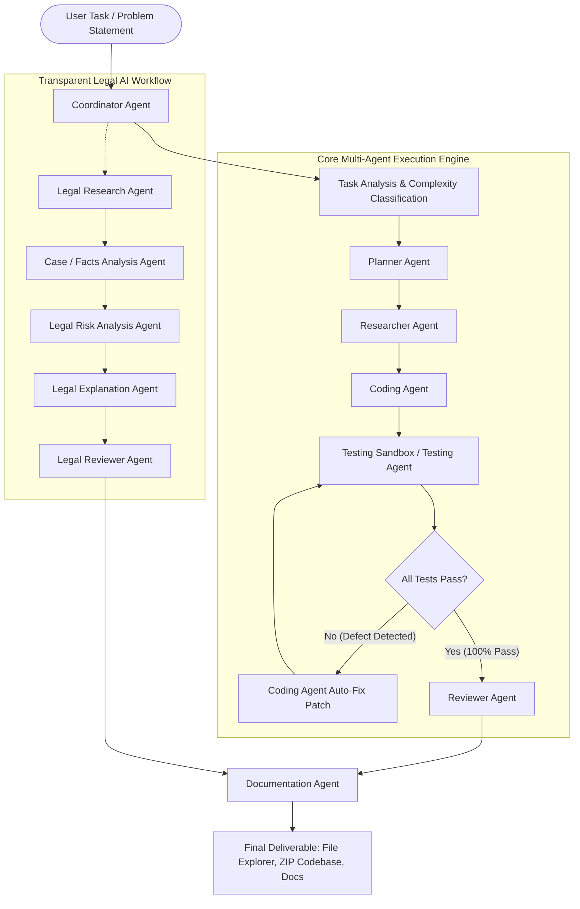

# AI Swarm: From Individual to Intelligent Teams
### College Major Project & Autonomous Multi-Agent Engineering Platform
*With Specialized Domain Application: **Transparent Legal AI***

---

## 1. Project Overview & Problem Statement

Modern software engineering and domain reasoning problems are too complex for monolithic, single-prompt AI assistants. Monolithic chatbots suffer from acute vulnerabilities: they hallucinate dependencies, produce single-script code that fails silently, provide no verification or testing loops, and lack role segregation and auditable transparency.

**AI Swarm: From Individual to Intelligent Teams** is an enterprise-grade, demonstrable, autonomous multi-agent AI system. Guided by a stateful **Coordinator Agent**, the platform receives complex user objectives, performs intelligent domain classification, decomposes requirements into dependency-mapped subtasks, delegates tasks to specialized autonomous agents, executes real sandboxed unit testing, runs **closed-loop automated defect self-correction**, performs security/architectural audits, generates real multi-file codebases on disk, and dynamically compiles publication-grade **22-section academic project documentation**.

The platform also features a specialized domain application: **Transparent Legal AI**, an auditable legal information and research assistant engineered with strict zero-hallucination citation constraints, factual extraction, liability risk matrices, and prominent non-advice disclaimers.

---

## 2. Core Architecture & Multi-Agent Swarm



### Specialized Agents & Responsibilities

| Agent | Operational Role | Key Deliverables & Responsibilities |
|---|---|---|
| **Coordinator Agent** | Master Orchestrator | Analyzes prompts, classifies project archetype, assigns agents, tracks dependencies, handles retries, coordinates aggregation. |
| **Planner Agent** | Subtask Architect | Decomposes high-level prompts into granular, dependency-linked subtask DAGs with execution schedules. |
| **Researcher Agent** | Technical Reference | Investigates algorithms, libraries, architectural patterns (PEP 8, Clean Architecture), and security standards. |
| **Coding Agent** | Lead Software Engineer | Generates real multi-file production code directly to disk (`generated_projects/<id>/...`) and synthesizes automated bug patches. |
| **Testing Agent** | QA Sandbox Engineer | Validates Python AST syntax, executes unit test assertions in an isolated subprocess, captures tracebacks, and triggers auto-fix loops. |
| **Reviewer Agent** | Security & Quality Auditor | Evaluates code quality, architectural standards, input sanitization, and issues scored approvals. |
| **Documentation Agent** | Academic Author | Dynamically synthesizes 22 publication-grade major project documentation sections based on live execution telemetry. |
| **Legal Research Agent** | Statutory Authority | Queries verified legal databases; provides authentic citations with a strict zero-hallucination guarantee. |
| **Case/Facts Analysis Agent** | Issue Framer | Extracts explicit facts from scenarios, isolates unverified assumptions, and identifies missing material info. |
| **Legal Risk Analysis Agent** | Exposure Assessor | Calculates liability probability, regulatory flux factors, and generates risk mitigation matrices. |
| **Legal Explanation Agent** | Plain Language Translator | Translates statutory citations into plain English, providing clear source-to-conclusion links. |
| **Legal Reviewer Agent** | Integrity & Ethics Auditor | Audits claims against authenticated authorities, eliminates overconfident language, and enforces mandatory legal disclaimers. |

---

## 3. Closed-Loop Testing & Defect Remediation Lifecycle

A core distinguishing capability of this project is the **autonomous testing and self-correction loop**:

```
Coding Agent (Generates Code)
      ↓
Testing Agent (Executes Isolated Unittest in Sandbox)
      ↓
Decision: Were Defects / Assertion Failures Detected?
 ├── YES → Failure Traceback Formatted → Coding Agent (Auto-Fix Patch) → Re-Test
 └── NO  → Passed 100% → Forward Codebase to Reviewer Agent
```

- When the test suite detects failures or assertion discrepancies, the `Testing Agent` captures the full traceback and failure context.
- The `Coordinator Agent` transitions state to `RETRYING` and dispatches an `ERROR` message back to the `Coding Agent`.
- The `Coding Agent` inspects the traceback, applies targeted code patches, rewrites the modified files on disk, and increments the retry count.
- The `Testing Agent` re-executes tests in the sandbox until all assertions pass cleanly, preventing infinite loops via configurable max retries (`MAX_TEST_RETRIES=3`).

---

## 4. Supported Project Types & Benchmarks

1. **Machine Learning Projects**:
   - Data pipeline, TF-IDF vectorization, PassiveAggressive text classification, FastAPI inference endpoint, unit tests.
   - Example: *"Build a Python fake-news detection system."*
2. **Full-Stack Web Applications**:
   - Relational modeling (Admin, Student, Driver, Bus, Route, Assignment), business service layer, and CRUD REST APIs.
   - Example: *"Build a college bus management system."*
3. **Data Analysis & Customer Segmentation**:
   - RFM metric calculation, variance computation, K-Means clustering, and segment profiling.
   - Example: *"Analyze customer segmentation data."*
4. **Research / Technical Reports**:
   - Architectural trade-off analysis, literature synthesis, and framework benchmarking.
5. **Transparent Legal AI**:
   - Fact-issue separation, statutory grounding, regulatory exposure matrix, plain-language translation, and disclaimer compliance.
   - Example: *"Is an employee non-compete clause enforceable if signed mid-tenure without additional monetary consideration?"*
6. **General Software Engineering Tasks**:
   - Clean architecture services, data structures, and CLI tools.

---

## 5. Local Setup & Execution Guide

### Prerequisites
- Python 3.11+
- Node.js v18+ (A portable Node.js v20 LTS is included in `.tools/node` for zero-install Windows execution!)

### Quick Start (Windows PowerShell)

#### Step 1: Start Backend API & Engine
```powershell
# Activate backend virtual environment
.\backend\venv\Scripts\Activate.ps1

# Run FastAPI backend server (Runs on http://127.0.0.1:8000)
uvicorn app.main:app --app-dir backend --host 127.0.0.1 --port 8000 --reload
```
*Swagger API Docs available at `http://127.0.0.1:8000/docs`.*

#### Step 2: Start Frontend Development Dashboard
```powershell
# Open a new PowerShell terminal
cd frontend
$env:PATH = "C:\Users\Admin\Downloads\AI Swarm\.tools\node;" + $env:PATH
npm run dev
```
*Frontend opens at `http://localhost:5173`.*

> **Single-Port Production Serving**:
> The backend automatically mounts the compiled frontend from `frontend/dist/`. 
> You can visit `http://127.0.0.1:8000/` directly in your browser to access the complete application and dashboard on a single port!

---

## 6. Automated Testing Verification

The backend includes a comprehensive automated test suite powered by `pytest`:

```powershell
.\backend\venv\Scripts\python.exe -m pytest backend/tests -v
```

### Verified Test Cases:
- `test_coordinator_classification`: Validates task analysis and dynamic agent selection.
- `test_planner_subtasks`: Verifies DAG subtask decomposition and execution scheduling.
- `test_researcher_domain_knowledge`: Tests technical architecture queries and library evaluation.
- `test_coder_and_tester_loop`: **Verifies closed-loop defect detection and automated code remediation**.
- `test_health_check`: Confirms API uptime and mode reporting.
- `test_list_agents`: Validates all 12 registered autonomous agents.
- `test_create_and_get_project`: Tests database persistence and schema validation.
- `test_legal_knowledge_base_search`: Validates zero-hallucination legal citation retrieval.
- `test_facts_decomposition`: Tests isolation of facts from assumptions and missing info.
- `test_legal_reviewer_mandatory_disclaimer`: Verifies statutory non-advice warning enforcement.

---

## 7. Automatic UML Generation & Visualization

After generating project source code, the workflow parses the generated Python modules and automatically saves five project-specific SVG diagrams in `generated_projects/<project_id>/uml/`. The class diagram extracts declared classes, attributes, methods, constructors, inheritance, and typed relationships from the generated source. The other diagrams describe the requested system capabilities, the live swarm sequence and correction flow, activities, and platform components.

Open the **Star UML System Design** tab for separate Use Case, Class, Sequence, Activity, and Component tabs. Diagrams are rendered as scalable graphics (the UI never shows diagram source text), can be zoomed and panned, and can be downloaded individually as SVG, PNG, or PDF. **Download All** packages all five diagrams in all three formats.

The project diagram API supports generation/regeneration, metadata retrieval, rendered SVG retrieval, and export:

- `POST /api/projects/{project_id}/diagrams/generate`
- `GET /api/projects/{project_id}/diagrams`
- `GET /api/projects/{project_id}/diagrams/{diagram_id}`
- `GET /api/projects/{project_id}/diagrams/{diagram_id}/export?format=svg|png|pdf`
- `GET /api/projects/{project_id}/diagrams/export/all`

SVG-to-PNG rendering uses `resvg-py` (including Windows wheels); PDF downloads package the rendered diagram on a page sized for the diagram.

---

## 8. Dynamic 22-Section Academic Project Report

When a swarm project completes, the `Documentation Agent` synthesizes a complete, publication-grade academic major project report:

1. Project Overview
2. Problem Statement
3. Objectives
4. Existing System
5. Proposed System
6. System Architecture (with Mermaid diagrams)
7. Agent Architecture
8. Workflow Specification
9. Technologies Used
10. Functional Requirements
11. Non-functional Requirements
12. Module Description
13. Agent Responsibilities Matrix
14. Database Design & Relational Schema
15. API Documentation
16. Implementation Details
17. Testing Methodology
18. Test Results & Metrics
19. Visual Interface Descriptions
20. Results & Evaluation Scorecard
21. System Limitations
22. Future Enhancements & Scope
23. Conclusion

*Reports can be read interactively in the dashboard with section jumping or downloaded as `.md`.*

---

## 9. Transparent Legal AI: Domain-Specific Application

Accessed via the **Transparent Legal AI** navigation tab:
- **Zero-Hallucination Policy**: Citations are queried strictly against curated statutory records and restatements (FTC Rule 910, Restatement of Contracts § 71/86, U.S. Copyright Office Compendium § 313.2, FTC 16 CFR Part 435, GDPR Articles 6/17).
- **Expandable Audit Trail**:
  1. *Facts Identified*: Explicit facts separated from unverified assumptions and missing material information.
  2. *Verified Authorities*: Authentic statutory citations and excerpts.
  3. *Risk Matrix*: Severity assessment, probability rating, and actionable mitigation measures.
  4. *Plain Explanation*: Source-to-conclusion link in accessible language.
  5. *Limitations*: Explicit jurisdictional scope constraints.
  6. *Mandatory Disclaimer*: Prominent notice emphasizing informational research use only.

---

## 10. Technology Stack Summary

- **Backend**: Python 3.11+, FastAPI, Uvicorn, SQLAlchemy, Pydantic v2, PyTest, AsyncIO.
- **Orchestration**: Stateful LangGraph-inspired execution engine with Server-Sent Events (SSE).
- **Database**: SQLite (local zero-configuration) / PostgreSQL compatible (13 relational audit tables).
- **LLM Engine**: OpenAI GPT API with high-fidelity, deterministic, offline **Demo Mode** fallback.
- **Frontend**: React 18, TypeScript, Vite, Tailwind CSS, Lucide React, JetBrains Mono typography.
- **Packaging & Deployment**: Docker, Docker Compose, NGINX, ZIP Codebase Exporter.

---

## 11. College Project Presentation Guide

For viva examinations, demonstrations, and college project evaluation:
1. **Introduction**: Introduce the paradigm shift from single-agent LLM prompting to collaborative multi-agent teams.
2. **Architecture**: Open the **Star UML System Design** tab and walk through the Class and Sequence diagrams.
3. **Task Input & Swarm Launch**: Go to **Task Input & Setup**, select "Fake News Detection System", and click "Start Autonomous Swarm".
4. **Live Orchestration DAG**: Switch to **Agent Workflow DAG** and show the Coordinator decomposing tasks while live pulse animations trace active agents.
5. **Auto-Fix Demo**: Show the **Testing & Auto-Fix** tab; highlight how the Testing Agent caught an assertion failure on iteration 1 and the Coding Agent repaired the code automatically.
6. **Code & File Tree**: Navigate to **Code & File Tree**; show the generated project files (`src/`, `tests/`, `requirements.txt`), inspect syntax, and download the `.ZIP` codebase.
7. **Academic Documentation**: View the **Academic Project Docs** tab; show the dynamically generated 22-section report.
8. **Transparent Legal AI**: Open the **Transparent Legal AI** tab, run a contract query, and demonstrate factual decomposition, verified citations, risk matrices, and legal disclaimers.
