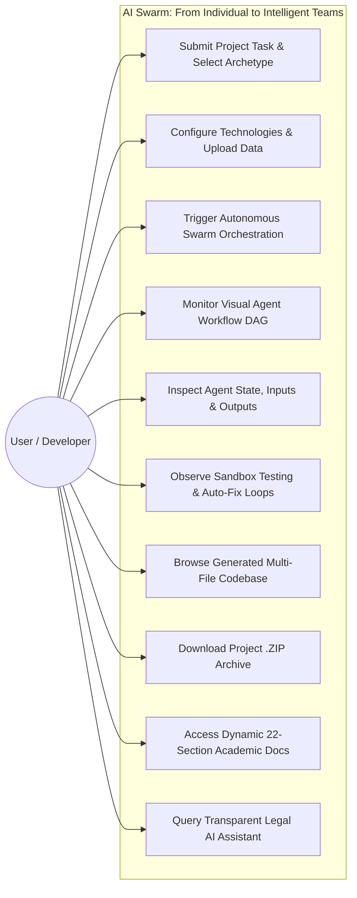

# Star UML: Use Case Diagram

## Actor Descriptions
- **User / Developer**: Initiates project requests, submits problem statements, selects technological constraints, inspects live multi-agent execution, reviews test reports, and downloads deliverables.

## Primary Use Cases
1. **Submit Project Task**: User defines project scope across ML, Web, Data Analysis, Research, Legal, or General software tasks.
2. **Trigger Swarm Orchestration**: Coordinator Agent classifies problem complexity, decomposes tasks, and activates specialized agents.
3. **Monitor Live DAG**: Displays live pulse animations and real-time state transitions (`WAITING`, `RUNNING`, `COMPLETED`, `FAILED`, `RETRYING`).
4. **Automated Testing & Auto-Fix Loop**: Testing Agent isolates defects in generated code and feeds failure tracebacks back to the Coding Agent for automated remediation.
5. **Transparent Legal AI**: Specialized workflow for fact-issue mapping, statutory retrieval, risk matrix assessment, and mandatory non-advice disclaimers.
